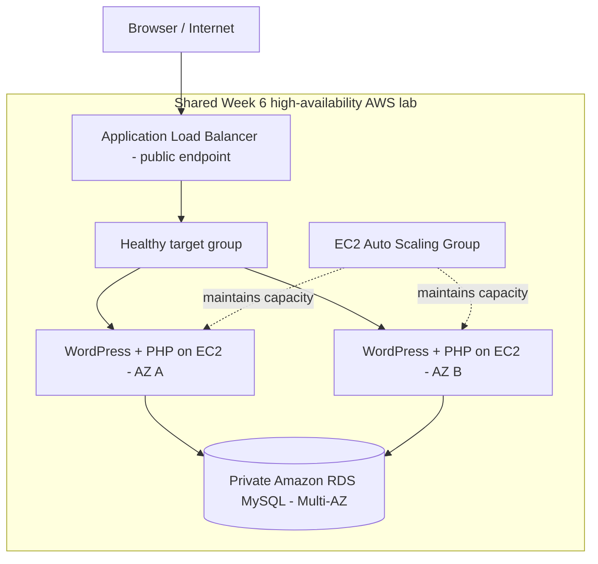
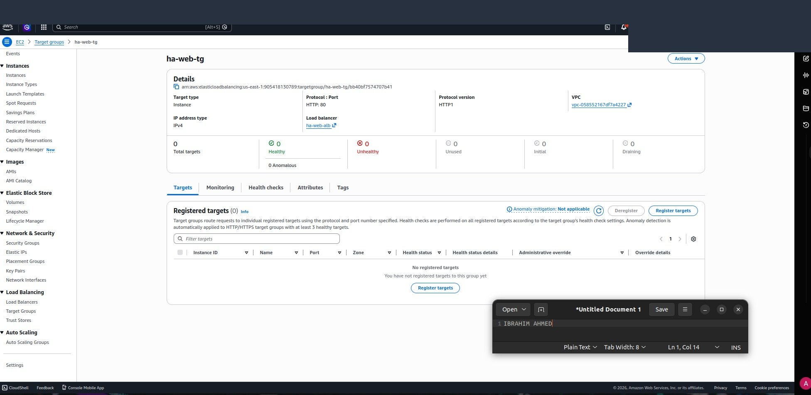
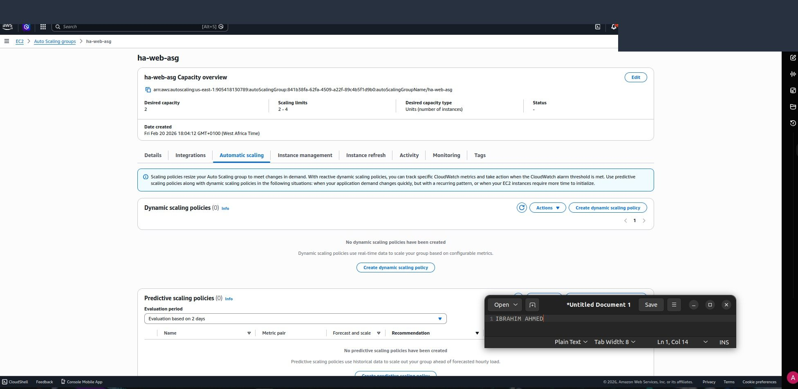
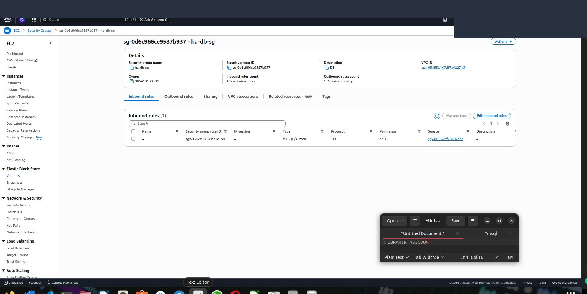
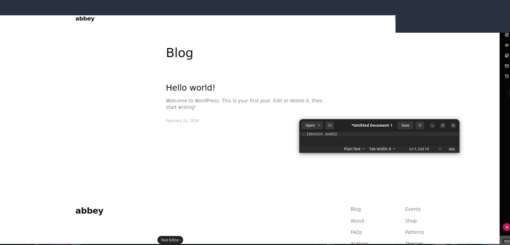
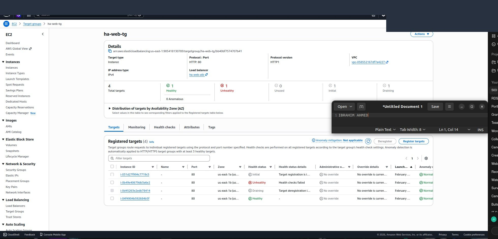

# WordPress on AWS | ALB, EC2 Auto Scaling & Private RDS

**WordPress administration · AWS infrastructure · High availability checks · Database integration**

This repository documents the **WordPress application deployment and recovery segment** of my **DevOps Micro Internship (DMI) Cohort 2 — Week 6** high-availability AWS exercise (submission: **27 February 2026**). I deployed WordPress on EC2, connected it to a private RDS database, accessed the site through an Application Load Balancer, and investigated HTTP 503/target-health errors.

> **Relationship to the other project:** The WordPress steps were carried out **within the same two-tier, multi-AZ AWS lab** documented in `aws-two-tier-high-availability`. This is a *separate application and operations case study*, **not** a claim that I independently rebuilt an entirely new cloud stack.

## Architecture

## Technologies

| Component | Role |
| --- | --- |
| AWS EC2 | Ubuntu web/application hosts |
| WordPress | Content management application |
| PHP-FPM and PHP modules | PHP runtime and MySQL integration |
| Amazon RDS MySQL | Private relational database (`dbwordpress` in the lab notes) |
| ALB and target group | Public entry point and HTTP health checks |
| Auto Scaling Group | Maintain/replace lab EC2 instances |
| AWS VPC, subnets, security groups | Network and access boundaries |
| MySQL CLI, Linux tools | Database and application troubleshooting |

## Implementation and verification

### 1. Configure the shared AWS application stack

The Week 6 report documents a public ALB, an EC2 Auto Scaling Group operating across two Availability Zones, and RDS in private subnets. Database access was restricted to the EC2 security group. This repository references these **shared lab components**, rather than claiming additional independent provisioning.

### 2. Deploy WordPress with RDS connectivity

For the WordPress portion of the lab, I installed the PHP modules needed by WordPress (including MySQL integration), configured its database settings to point to **RDS**, and verified database connectivity using the MySQL command-line client. I accessed WordPress through the ALB DNS endpoint and tested database read/write operations.

### 3. Investigate HTTP 503 and unhealthy targets

The reported error was **503 Service Unavailable** while ALB targets were deregistered or unhealthy. I:

1. Inspected target-group health and port configuration.
2. Re-registered running EC2 instances with the target group.
3. Checked ALB-to-EC2 security-group rules.
4. Confirmed WordPress and PHP-FPM were running.
5. Tested RDS connectivity from EC2 and revisited the site through the ALB.

### 4. Controlled availability exercise

The submission records an **instance detach-and-replace exercise** with Auto Scaling replacement enabled. WordPress remained browser-accessible through the ALB during the observation window. **Detaching one instance is not the same as proving an actual full-AZ outage.**

Additional operational notes are in [docs/wordpress-operations.md](docs/wordpress-operations.md).

## Outcomes and limitations

- Deployed and reached WordPress through an ALB.
- Connected WordPress to an RDS MySQL database and validated read/write operations.
- Investigated unhealthy ALB targets and resolved an observed 503 issue.
- Practiced checking instance replacement/target group health in an Auto Scaling environment.

**Limits:** The report does not show a complete, reproducible WordPress bootstrap script, shared-media/storage strategy, WordPress database migration plan, TLS certificate, or production-ready hardening. This repository is a **documented lab**, not a public production WordPress template.

**Evidence:** Images from the Week 6 report (pages 43, 51–57). These include shared two-tier infrastructure. Browser/account headers were masked; verify screenshots before publishing.

## Skills demonstrated

`AWS EC2` · `WordPress` · `PHP-FPM` · `MySQL` · `Amazon RDS` · `ALB` · `Auto Scaling` · `Linux` · `Troubleshooting` · `HTTP 503` · `Target Groups` · `High Availability Testing`

## Author

**Ibrahim Ahmed Abiodun**  
GitHub: [@slim274](https://github.com/slim274)  
**Training:** DevOps Micro Internship — Cohort 2, Week 6, Assignment 3 (WordPress segment)
