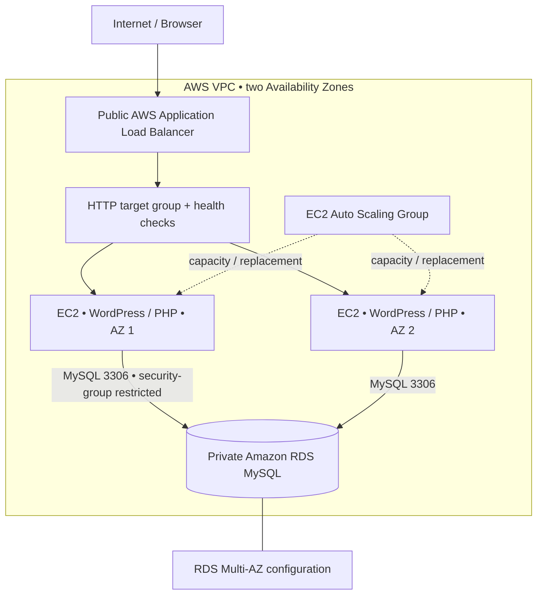
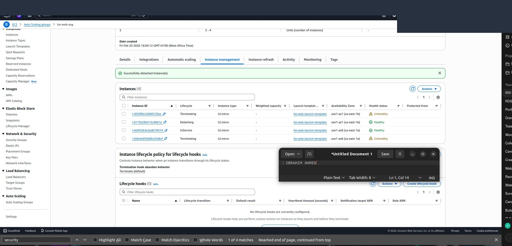

# WordPress Two-Tier High-Availability Deployment on AWS

**AWS EC2 · Application Load Balancer · Auto Scaling · Amazon RDS MySQL · WordPress/PHP**

**DevOps Micro Internship (DMI) — Cohort 2 | Week 6, Assignment 3 | February 2026**

## Project overview

I deployed and troubleshot **WordPress** on AWS EC2, integrated it with a **private Amazon RDS MySQL database**, and accessed the site through an **Application Load Balancer (ALB)** in a multi-Availability Zone (AZ) lab. I resolved HTTP 503 / unhealthy-target issues and performed an instance detach-and-replace availability check.

This repository documents the **WordPress phase** of my Week 6 high-availability exercise. The same lab also used a **separate PHP hit-counter** to test EC2 bootstrapping earlier in the assignment. **EpicBook is a different Node.js project and is not the application deployed here.**

A two-tier architecture means the **WordPress web/application tier** is separate from the **MySQL database tier**. The ALB and Auto Scaling Group support availability and capacity; they are not additional application tiers.

## AWS architecture

*The assignment report describes networking across two AZs and a private RDS database. Its notes disagree about whether ASG instances were launched in public or private subnets; this diagram intentionally does not assert an unverified EC2 subnet placement.*

## What I implemented

1. **Network and access controls:** configured VPC networking, public/private subnets, routing/NAT, and security groups for the ALB, EC2, and RDS.
2. **Load balancing and capacity:** configured the internet-facing ALB, target group/HTTP checks, and an Auto Scaling Group with desired capacity 2 (minimum 2, maximum 4).
3. **Private MySQL:** used Amazon RDS MySQL, with inbound database access restricted to the application hosts.
4. **WordPress deployment:** installed WordPress and the required PHP/PHP-FPM MySQL components; configured the WordPress database (`dbwordpress` in my notes); tested database read/write operations.
5. **Incident response:** investigated a `503 Service Unavailable` response and unhealthy/deregistered targets; re-registered targets, reviewed ports and security groups, and checked WordPress/PHP and RDS connections.
6. **Availability exercise:** detached an instance with replacement enabled, then confirmed that WordPress remained accessible through the ALB during the recorded observation.

## Deployment evidence

These images come from my **Week 6 internship submission**, not a currently running production service. The captions describe what each screenshot actually shows.

| Target group | Auto Scaling |
|:--:|:--:|
|  |  |
| **RDS access security group** | **WordPress site** |
|  |  |
| **Instance lifecycle** | **Target health** |
|  |  |

See [screenshot provenance](screenshots/EVIDENCE_SOURCES.md) and the [operations runbook](docs/wordpress-operations.md).

## Results and limitations

- **Verified in the report:** WordPress loaded through the ALB; EC2↔RDS connectivity and WordPress read/write operations succeeded; a 503/target-health issue was investigated and addressed.
- **Availability evidence:** an instance detach-and-replace test was recorded. This **does not prove a full AZ outage or guaranteed uninterrupted production operation**.
- **Not demonstrated:** reliable automated WordPress installation on replacement instances; shared WordPress media/files; HTTPS/TLS; production security hardening; backup/restore procedures; end-to-end load testing.
- **Deployment status:** this is a historical internship lab, **not a claim of a currently running public AWS endpoint**.

## Skills demonstrated

**Cloud & infrastructure:** AWS EC2, VPC, subnets, route tables, Internet Gateway, NAT Gateway, security groups, ALB, target groups, EC2 Auto Scaling, RDS MySQL, Multi-AZ concepts.

**Operations & troubleshooting:** Ubuntu/Linux administration, WordPress deployment, PHP/PHP-FPM, MySQL CLI, HTTP health checks, 503 incident investigation, instance lifecycle and replacement testing, security-group troubleshooting, technical documentation.

## Credit and ownership

- **Original software:** [WordPress](https://wordpress.org/), an open-source CMS developed by **WordPress contributors** (GPLv2 or later). I do **not** claim authorship of WordPress core.
- **My contribution:** AWS infrastructure configuration, WordPress deployment and database integration, troubleshooting, operational verification, and this DevOps case study.
- **Internship:** DevOps Micro Internship (DMI), Cohort 2.
- **Portfolio author:** [@slim274](https://github.com/slim274).

**GitHub naming:** Current repo: [`aws-wordpress-alb-rds`](https://github.com/slim274/aws-wordpress-alb-rds). Recommended descriptive name: `aws-wordpress-two-tier-high-availability`. Rename only after you are ready; instructions are in [docs/GITHUB_RENAME.md](docs/GITHUB_RENAME.md).
